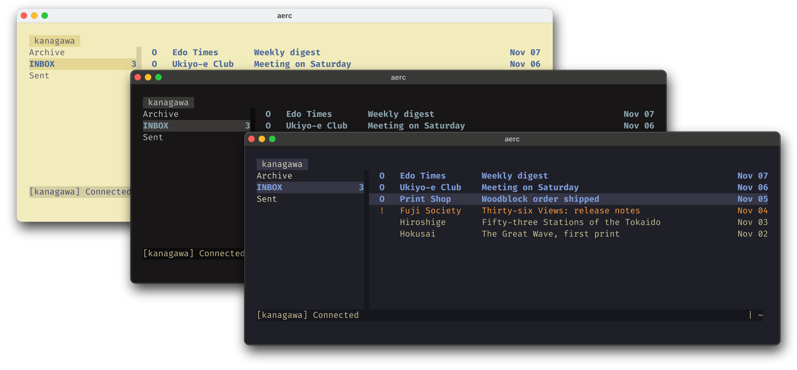
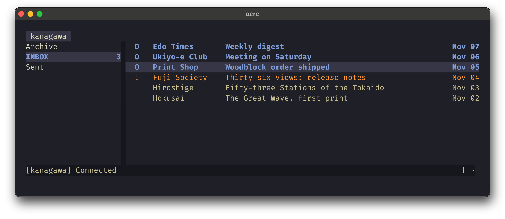
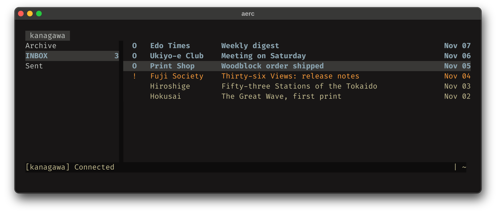
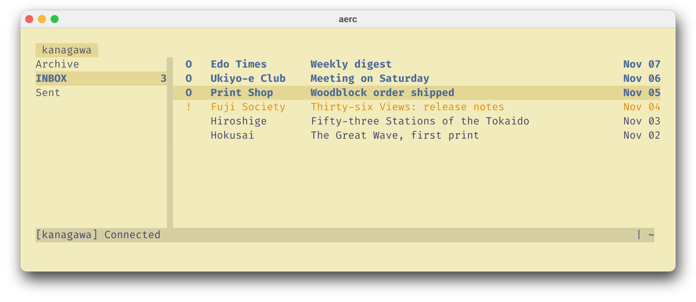

<h3>Kanagawa for <a href="https://aerc-mail.org/">aerc</a></h3>
<p>A community-maintained theme inspired by Hokusai's <em>The Great Wave off Kanagawa</em>.</p>
<p>Using the <a href="https://github.com/rebelot/kanagawa.nvim">Kanagawa palette</a> by <a href="https://github.com/rebelot">Tommaso Laurenzi (rebelot)</a>.</p>

<!-- Wave accents: carpYellow, crystalBlue, autumnRed. Lotus accents: lotusYellow, lotusBlue4, lotusRed. -->
<p>
  <a href="https://github.com/kanagawa-community/aerc/stargazers">
    <picture>
      <source media="(prefers-color-scheme: dark)" srcset="https://img.shields.io/github/stars/kanagawa-community/aerc?style=for-the-badge&amp;labelColor=1F1F28&amp;color=E6C384">
      <source media="(prefers-color-scheme: light)" srcset="https://img.shields.io/github/stars/kanagawa-community/aerc?style=for-the-badge&amp;labelColor=F2ECBC&amp;color=77713F">
      
    </picture>
  </a>
  <a href="https://github.com/kanagawa-community/aerc/releases/latest">
    <picture>
      <source media="(prefers-color-scheme: dark)" srcset="https://img.shields.io/github/v/release/kanagawa-community/aerc?style=for-the-badge&amp;label=release&amp;labelColor=1F1F28&amp;color=7E9CD8">
      <source media="(prefers-color-scheme: light)" srcset="https://img.shields.io/github/v/release/kanagawa-community/aerc?style=for-the-badge&amp;label=release&amp;labelColor=F2ECBC&amp;color=4D699B">
      
    </picture>
  </a>
  <a href="https://github.com/kanagawa-community/aerc/issues">
    <picture>
      <source media="(prefers-color-scheme: dark)" srcset="https://img.shields.io/github/issues/kanagawa-community/aerc?style=for-the-badge&amp;labelColor=1F1F28&amp;color=C34043">
      <source media="(prefers-color-scheme: light)" srcset="https://img.shields.io/github/issues/kanagawa-community/aerc?style=for-the-badge&amp;labelColor=F2ECBC&amp;color=C84053">
      
    </picture>
  </a>
</p>

<br clear="both">
<br>

## Previews



<details>
<summary>🌊 Wave</summary>

</details>

<details>
<summary>🐉 Dragon</summary>

</details>

<details>
<summary>🪷 Lotus</summary>

</details>

## Requirements

- aerc 0.15 or later, with a terminal that supports truecolor.

## Installation

Download the three themes into ~/.config/aerc/stylesets:

```sh
mkdir -p ~/.config/aerc/stylesets
for variant in wave dragon lotus; do
  curl -fsSL -o ~/.config/aerc/stylesets/kanagawa-$variant https://raw.githubusercontent.com/kanagawa-community/aerc/main/themes/kanagawa-$variant
done
```

Or clone the repository and run `./install.sh`. It installs all three variants,
or only the ones you name, for example `./install.sh dragon lotus`. `./uninstall.sh`
takes the same names and removes them.

## Usage

Set the styleset in `~/.config/aerc/aerc.conf`:

```ini
[ui]
styleset-name=kanagawa-wave
```

## Palette

Every color comes from the shared
[palette](https://github.com/kanagawa-community/.github/blob/main/docs/PALETTE.md),
picked by role, so each variant uses its own value for the same role.

| aerc color                                   | Palette role              |
| -------------------------------------------- | ------------------------- |
| `default`                                    | `ui.fg` on `ui.bg`        |
| `statusline_default`                         | `ui.fg_dim` on `ui.bg_m3` |
| `tab`, `border`                              | `ui.bg_m3`                |
| `tab.selected`, `*.selected`                 | `ui.fg` on `ui.bg_p2`     |
| `header`, `msglist_unread`, `dirlist_unread` | `syn.fun`                 |
| `msglist_read`                               | `ui.fg_dim`               |
| `msglist_marked`                             | `syn.constant`            |
| `msglist_flagged`, `warning`                 | `diag.warning`            |
| `msglist_deleted`                            | `vcs.removed`             |
| `msglist_result`                             | `syn.string`              |
| `error`, `success`                           | `diag.error`, `diag.ok`   |

## Credits

This port replaces the aerc theme in the `extras` folder of the
[Neovim plugin](https://github.com/kanagawa-community/neovim). Kenneth Flak first contributed that theme to kanagawa.nvim. The
colors come from [kanagawa.nvim](https://github.com/rebelot/kanagawa.nvim) by
Tommaso Laurenzi.

## Issues and contributions

Report bugs and request changes in this port's
[issue tracker](https://github.com/kanagawa-community/aerc/issues). Contributions are welcome.

See [CONTRIBUTING.md](CONTRIBUTING.md) before opening a pull request.

## License

MIT. See [LICENSE](LICENSE).
